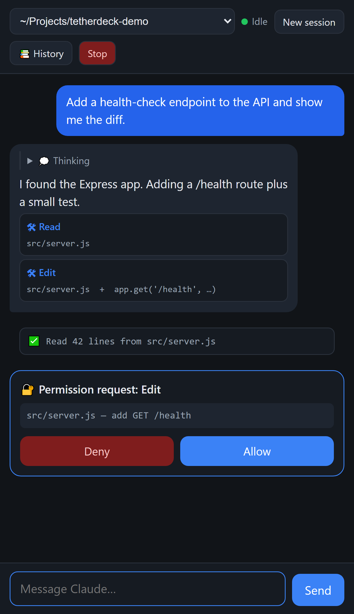
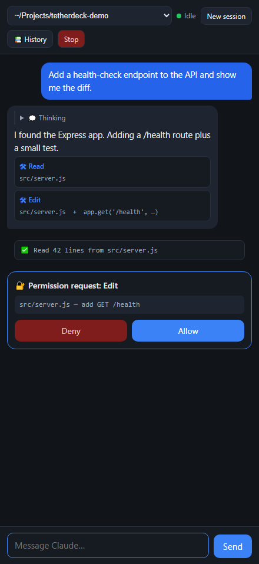

# TetherDeck

An open-source iOS client for [Claude Code](https://claude.com/claude-code) running on your own computer.

Start a task on your desktop, watch it run, approve tool calls, and get notified when it finishes — from your phone, over your own network. No account, no cloud relay of ours, no analytics.

<p align="center">
  
  
</p>

## What this actually is

TetherDeck is a thin native shell. The chat interface you interact with is served by a small bridge process on your computer; the app loads that page in a `WKWebView` and adds the parts a web page cannot do well on iOS:

- **Native settings** — server address(es) and access token, kept in the Keychain
- **Token auto-login** — injected before the page loads, so you never see the bridge's login form
- **Native session history** — jump back into an earlier Claude Code session
- **Native approval bar** — allow or deny a pending tool call without hunting for it in the transcript
- **Local notifications** — when a task finishes, errors, or needs your approval
- **Multiple server addresses** — a LAN address and a Tailscale address for the same bridge; the app tries them in order and remembers whichever one answered
- **Offline demo** — a bundled snapshot of the UI, so you can try the app with no server at all

## What it is not

- **Not a proxy to Anthropic.** The app never talks to Anthropic's API. It talks to *your* computer, which runs Claude Code with *your* credentials.
- **Not a hosted service.** There is no TetherDeck backend. If your computer is off, nothing works.
- **Not a remote shell.** It drives one bridge process over HTTP; it does not give you SSH.

## Requirements

| | |
|---|---|
| Phone | iOS 16 or later |
| Computer | macOS / Linux / Windows, running the bridge on port `8789` |
| Network | Same Wi-Fi, or a Tailscale / WireGuard / tunnel address when you are away |
| Build toolchain | Node 20+, Expo SDK 57, EAS CLI, Xcode (for local builds) |

## Architecture

```
┌──────────────────────────────────────────────────────────────┐
│ TetherDeck (Expo SDK 57, React Native 0.86)                  │
│                                                              │
│  App.tsx        route: settings ⇄ chat ⇄ demo                 │
│  ChatScreen     <WebView source={serverUrl + '/'}>           │
│                 failover: next address on load error         │
│    │                                                         │
│    │  injectedJavaScriptBeforeContentLoaded                  │
│    │  (src/bridge/injection.ts)                              │
│    │    ① POST /api/login with the stored token → cookie     │
│    │    ② observe the page's `state` object + DOM mutations  │
│    │    ③ postMessage only when something actually changed   │
│    ▼                                                         │
│  Native layer                                                │
│    expo-secure-store        server address + token           │
│    expo-notifications       finish / error / approval alerts │
└──────────────────────────────────────────────────────────────┘
                     │  plain HTTP on your own network
                     ▼
        ┌────────────────────────────────────┐
        │ bridge on your computer :8789      │
        │  GET  /            the web UI      │
        │  GET  /api/sse     state stream    │
        │  GET  /api/state   snapshot        │
        │  POST /api/login   token → cookie  │
        │  POST /api/session send / resume   │
        └────────────────────────────────────┘
```

The bridge is a separate piece of software and is not part of this repository. Any server that speaks the contract above will work.

## Build it yourself

```bash
npm install

# point app.json at your own bundle id and EAS project first
npx expo prebuild --platform ios

# local simulator run
npx expo run:ios

# App Store build
eas build --platform ios --profile production
eas submit --platform ios --latest
```

`eas.json` ships with the author's App Store Connect identifiers so that the publish workflow keeps working. **If you fork this, replace `ascAppId`, `ascApiKeyId` and `ascApiKeyIssuerId`, and put your own `.p8` in `ios-creds/`** (that directory is gitignored).

## Security and privacy

- The access token lives in the iOS Keychain via `expo-secure-store`.
- All traffic goes directly to the address you typed. Nothing is sent to the author or to any third party.
- The app contains no analytics, no crash reporting, no advertising SDK, and no tracking of any kind.
- Traffic is **plain HTTP by default** because a server you run at home has no certificate the app could validate. Put the bridge behind Tailscale, WireGuard, or an SSH tunnel rather than exposing port `8789` to the internet.

## Status

TetherDeck 1.0.3 is live on the App Store. 1.0.4 is in review.

1.0.4 tightens the multi-address failover:

- a 15-second per-address deadline, so a blackholed address no longer stalls for a full URLSession timeout
- an address only counts as working once the page actually delivers bridge state, so a captive portal or any other HTTP 200 page is not mistaken for the bridge
- load errors clear on success, and late errors from a previous address no longer skip the next one
- the bridge page now acknowledges a reconnect only after the event stream is actually open

## License

MIT — see [LICENSE](LICENSE).

---

## 中文简介

TetherDeck 是一个开源的 iOS 客户端，用来在手机上操作**跑在你自己电脑上**的 Claude Code。

电脑端跑一个桥服务（默认 `8789` 端口），App 把它的界面套进原生壳：设置页记住地址和口令（存 Keychain）、自动登录、原生会话历史、原生审批按钮、完成/出错/待审批的本地通知。可以同时填局域网地址和 Tailscale 地址，按顺序自动挑能通的那个。

不经过任何第三方服务器，App 不跟 Anthropic 通信，也没有账号、埋点、广告 SDK。桥服务需要你自己部署；家里那台机器关机，App 就是空的。

代码 MIT 授权。
